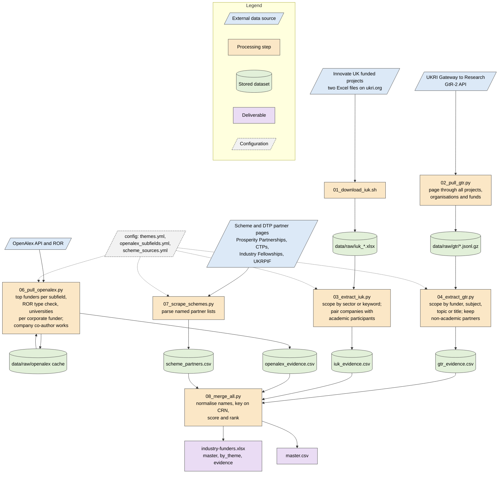

# industry-funders

Evidence-based target list of companies that have funded university research
in the biological and chemical sciences: PhD studentships, fellowships,
Knowledge Transfer Partnerships and collaborative grants. Built for the
School of Biological and Chemical Sciences, Manchester Metropolitan
University. The proposal that this implements is
`industry-funders-plan.pdf` (rebuild with `python build_plan.py`).

The four sources of the plan are implemented: UKRI Gateway to Research and
the Innovate UK funded-projects data (Phase 1), OpenAlex corporate funders
and company co-authors (Phase 2), and named scheme and partner pages
(Phase 3). Studentship adverts are not scraped (site terms of use); they
can be added by hand to `data/processed/scheme_partners.csv`.

## Pipeline



Shapes follow the ISO 5807 flowchart convention: parallelograms are inputs,
rectangles are processes, cylinders are stored data, and the final boxes are
deliverables.

## Running it yourself

Everything runs from this folder with Docker Desktop and nothing else
installed. The steps below are written for a rerun at a later date by
someone who has not used the pipeline before.

**One-time setup**

1. Install Docker Desktop (docker.com) and start it.
2. Clone the repository:

```bash
git clone git@github.com:remizallot/industry-funders.git
```

3. Optional but recommended: a free OpenAlex API key from
   openalex.org/settings/api, saved as the only content of
   `config/openalex_key.txt`. Without it the company co-author route is
   skipped and the funder route shares a small daily request budget.

**Rebuild everything from current public data (about an hour)**

```bash
bash scripts/run_in_docker.sh
```

This downloads the Innovate UK spreadsheets, pages through the whole
Gateway to Research catalogue (the slow part, resumable if interrupted),
queries OpenAlex, scrapes the scheme pages, merges, scores and writes
`industry-funders-ranked.xlsx` and `industry-funders-explorer.html` in this
folder. Rerunning only the later steps is possible with
`docker compose run --rm --no-deps pipeline python scripts/08_merge_all.py`
and so on; each script is independent and reads the files of the one
before it.

**Optional: theme classification with a local language model (hours)**

```bash
bash scripts/run_llm_themes.sh
```

This starts a model server (Ollama) in Docker, downloads two small open
models on first use (an embedding model, about 0.3 GB, and a 3-billion
parameter chat model, about 2 GB), classifies every project behind the
evidence, then rebuilds the workbook and explorer. The embedding pass takes
minutes; the chat-model pass runs on the CPU inside Docker and takes a few
seconds per project, so by default it is limited to 3,000 projects per run,
prioritising projects behind studentships, fellowships, KTPs and named
partnerships. Every answer is cached, so running the script again continues
where it stopped. `--max-llm 0` runs embeddings only; `--llm-model
qwen2.5:7b` uses a larger, slower model. The classifier replaces the keyword
themes for the projects it has seen and records a one-line justification per
project, shown in the explorer as a "why" line.

**Changing the scope**

The subject scope is specific to the School of Biological and Chemical
Sciences. For another school, edit the themes, keywords and UKRI subjects in
`config/themes.yml`, the OpenAlex subfields in
`config/openalex_subfields.yml`, and the Innovate UK sectors in
`config/themes.yml`, then rerun from `03_extract_iuk.py` onwards.

**Without Docker**

```bash
python3 -m venv .venv && .venv/bin/pip install -r requirements.txt
```

then `bash scripts/run_all.sh` with `python` on the PATH pointing at
`.venv/bin/python`. The language-model stage needs an Ollama server
reachable at `OLLAMA_HOST` (the native Ollama app on a Mac uses the GPU and
is several times faster than the Docker service).

## Interactive explorer

`scripts/09_build_explorer.py` writes `industry-funders-explorer.html`, a
single self-contained page (about 11 MB) that opens directly in a browser
with no server. It filters by company name or alias, university worked
with, project text, year range (scores are recomputed for the range),
company country, organisation type, theme, scheme or funder, evidence
types counted, North West address and prior work with Manchester
Metropolitan. Each row expands to list the evidence, and the filtered
list downloads as CSV. The page is rebuilt by `run_all.sh`.

## How scope is decided

Scope is inclusion-first so that nothing in the School's remit is dropped
at source; precision comes later from scoring and review.

- Innovate UK: a project is in scope if its sector is one of the always-in
  sectors in `config/themes.yml` (health and nutrition, life and land, life
  sciences, engineering biology, vaccines, agri-tech, energy and
  environment) or a theme keyword matches the title or public description.
  Only projects with at least one academic and one non-academic participant
  are kept.
- GtR: a project is in scope if its lead funder is BBSRC, NERC or MRC, or a
  UKRI research subject or topic maps to a theme, or a theme keyword matches
  the title or abstract. Only non-academic organisations linked as Project
  Partner or collaborator are kept, paired with the lead organisation.
- OpenAlex: works are restricted to the subfields in
  `config/openalex_subfields.yml` (molecular and cell biology through to
  materials chemistry and fuel technology), UK university authors and
  publication years from 2015. A funder counts as corporate when its ROR
  record has type "company", or, with no ROR record, when its name reads
  like a company.
- Scheme pages: named lists of industry-academic partnerships; sources and
  parsing strategies are recorded in `config/scheme_sources.yml`.
- Academic and public bodies are recognised by name patterns in the config
  (university, college, NHS, institute, council, charity and so on).

## Scoring

Each evidence row earns points by type, scaled by recency over twenty years:
studentship 3, fellowship 2, KTP 2, named scheme partnership 2, research
grant 1, other Innovate UK project 0.5. OpenAlex rows earn 0.15 per paper
funded and 0.05 per paper co-authored, capped at 40 papers per company and
university pair, so publication volume supports but never dominates the
direct evidence of funded people. Companies are keyed on Companies House registration number
where either source gives one, otherwise on a normalised name with legal
suffixes removed. The `master` sheet gives the ranked list with counts per
evidence type, universities worked with, whether the company has worked
with Manchester Metropolitan, a North West flag from postcode or region,
and the School themes its projects match. The `by_theme` sheet ranks
companies within each theme and `evidence` holds every underlying row.

## Known limits

- Theme keywords are deliberately broad; aerospace and automotive companies
  appear through materials and emissions terms and will need manual review
  or tighter keywords in `config/themes.yml`.
- GtR organisation records rarely carry a registration number, so GtR-only
  companies are keyed on name and may split across spelling variants.
- GtR records partner contributions as declared at award; block doctoral
  training grants list the grant rather than every industrial student.
