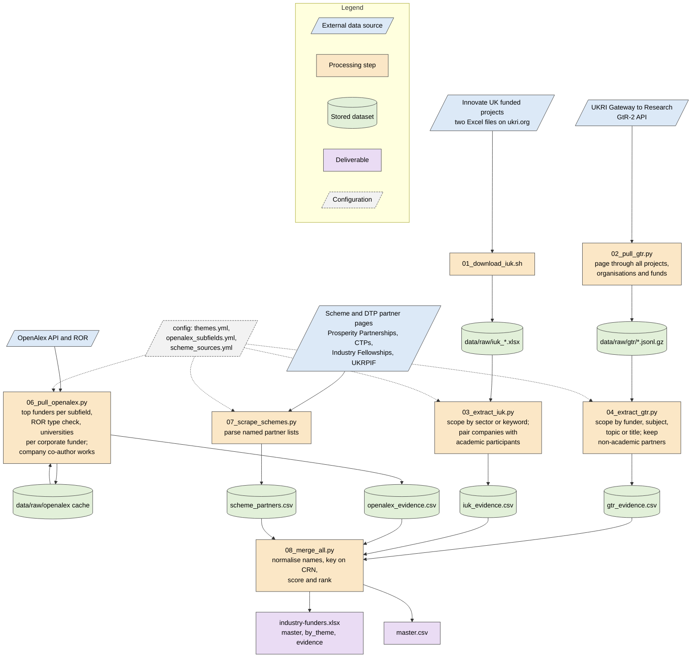

# industry-funders

Evidence-based target list of companies that have funded university research
in the biological and chemical sciences: PhD studentships, fellowships,
Knowledge Transfer Partnerships and collaborative grants. Built for the
School of Biological and Chemical Sciences, Manchester Metropolitan
University. The proposal that this implements is
`industry-funders-plan.pdf` (rebuild with `python build_plan.py`).

The four sources of the plan are implemented: UKRI Gateway to Research and
the Innovate UK funded-projects data (Phase 1), OpenAlex corporate funders
and company co-authors (Phase 2), and named scheme and partner pages
(Phase 3). Studentship adverts are not scraped (site terms of use); they
can be added by hand to `data/processed/scheme_partners.csv`.

## Pipeline



Shapes follow the ISO 5807 flowchart convention: parallelograms are inputs,
rectangles are processes, cylinders are stored data, and the final boxes are
deliverables.

## Running

With Docker:

```bash
docker build -t industry-funders .
```

```bash
docker run --rm -v "$PWD/data:/work/data" industry-funders
```

Without Docker:

```bash
python3 -m venv .venv && .venv/bin/pip install -r requirements.txt
```

```bash
.venv/bin/python scripts/02_pull_gtr.py
```

then run the remaining scripts in order, or `bash scripts/run_all.sh`
for the whole pipeline. The GtR pull fetches about 160,000 projects plus
organisations and funds at 100 records per request with a short pause
between requests, so allow an hour. It is resumable: rerunning continues
from the last completed page recorded in `data/raw/gtr/*.progress`.

OpenAlex shares a free daily request budget per network address. The
puller caches every response, stops cleanly when the budget is exhausted
and resumes from the cache on the next run; the company co-author route needs a
free API key from openalex.org/settings/api, which also raises the budget.
Save the key as the only content of `config/openalex_key.txt` (gitignored)
or export it as `OPENALEX_API_KEY`, then rerun `06_pull_openalex.py` and
`08_merge_all.py`. Without a key the co-author route is skipped.

## How scope is decided

Scope is inclusion-first so that nothing in the School's remit is dropped
at source; precision comes later from scoring and review.

- Innovate UK: a project is in scope if its sector is one of the always-in
  sectors in `config/themes.yml` (health and nutrition, life and land, life
  sciences, engineering biology, vaccines, agri-tech, energy and
  environment) or a theme keyword matches the title or public description.
  Only projects with at least one academic and one non-academic participant
  are kept.
- GtR: a project is in scope if its lead funder is BBSRC, NERC or MRC, or a
  UKRI research subject or topic maps to a theme, or a theme keyword matches
  the title or abstract. Only non-academic organisations linked as Project
  Partner or collaborator are kept, paired with the lead organisation.
- OpenAlex: works are restricted to the subfields in
  `config/openalex_subfields.yml` (molecular and cell biology through to
  materials chemistry and fuel technology), UK university authors and
  publication years from 2015. A funder counts as corporate when its ROR
  record has type "company", or, with no ROR record, when its name reads
  like a company.
- Scheme pages: named lists of industry-academic partnerships; sources and
  parsing strategies are recorded in `config/scheme_sources.yml`.
- Academic and public bodies are recognised by name patterns in the config
  (university, college, NHS, institute, council, charity and so on).

## Scoring

Each evidence row earns points by type, scaled by recency over twenty years:
studentship 3, fellowship 2, KTP 2, named scheme partnership 2, research
grant 1, other Innovate UK project 0.5. OpenAlex rows earn 0.15 per paper
funded and 0.05 per paper co-authored, capped at 40 papers per company and
university pair, so publication volume supports but never dominates the
direct evidence of funded people. Companies are keyed on Companies House registration number
where either source gives one, otherwise on a normalised name with legal
suffixes removed. The `master` sheet gives the ranked list with counts per
evidence type, universities worked with, whether the company has worked
with Manchester Metropolitan, a North West flag from postcode or region,
and the School themes its projects match. The `by_theme` sheet ranks
companies within each theme and `evidence` holds every underlying row.

## Known limits

- Theme keywords are deliberately broad; aerospace and automotive companies
  appear through materials and emissions terms and will need manual review
  or tighter keywords in `config/themes.yml`.
- GtR organisation records rarely carry a registration number, so GtR-only
  companies are keyed on name and may split across spelling variants.
- GtR records partner contributions as declared at award; block doctoral
  training grants list the grant rather than every industrial student.
